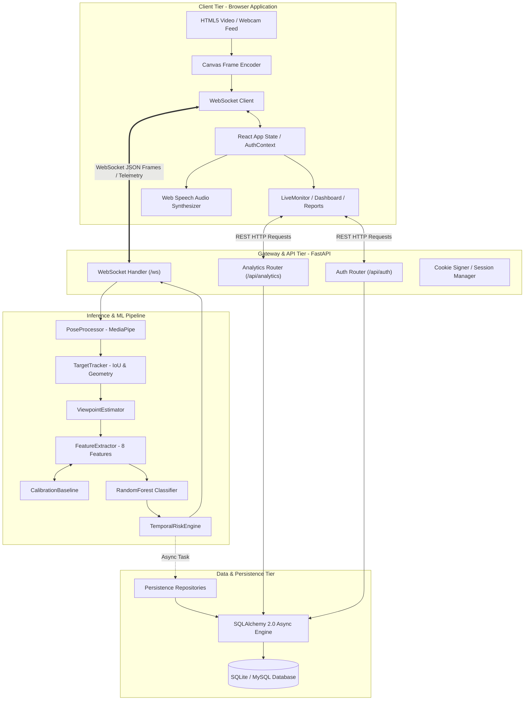
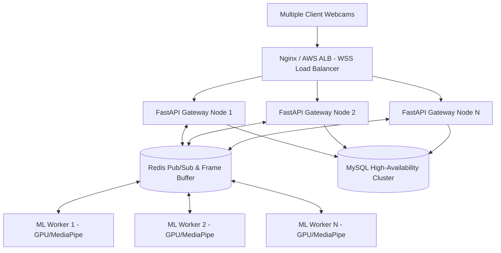

# PostureAI — System Architecture & Dataflow Specification

**Document Code:** `DOC-02-ARCH`  
**Relative Path:** `documents/02_SYSTEM_ARCHITECTURE_AND_DATAFLOW.md`  
**System Version:** 2.0  
**Backend Framework:** FastAPI / Python 3.10+  
**Frontend Framework:** React 18 / Vite / Tailwind CSS  

---

## 1. High-Level Architectural Topology

PostureAI is architected as an asynchronous, event-driven, decoupled client-server system designed for low-latency real-time inference and high scalability. The architecture is structured into four distinct logical tiers:



---

## 2. Detailed Component Breakdown

### 2.1 Client Tier (Browser Application)
* **Webcam & Canvas Pipeline (`useCamera.js`, `CameraView.jsx`):** Accesses user media via `navigator.mediaDevices.getUserMedia({ video: true })`. Periodically captures uncompressed video frames onto an offscreen HTML5 `<canvas>`, serializes them into compressed Base64 JPEG strings, and passes them to the communication hook.
* **WebSocket Client (`useWebSocket.js`, `useMonitoring.js`):** Establishes a persistent, bi-directional full-duplex WebSocket connection to `/ws`. Sends periodic `FRAME` payloads containing timestamped image data and receives structured `POSTURE_UPDATE`, `ALERT`, or `CALIBRATION_STATE` messages.
* **Pose Overlay Canvas (`PoseOverlay.jsx`):** Renders high-performance visual feedback directly atop the live video feed. Draws candidate bounding boxes, active target highlight boxes, 33 2D skeletal landmarks, colored bone connections, and posture misalignment callouts.
* **Audio Voice Alert Engine (`useVoiceAlert.js`):** Integrates with the browser's native `window.speechSynthesis` API. Speaks human-like verbal guidance (e.g., *"Trunk misaligned, please sit upright"*) without requiring external TTS cloud dependencies.
* **State Management (`AuthContext.jsx`, `store.js`):** Manages user session state, WebSocket connectivity states (`CONNECTING`, `OPEN`, `CLOSING`, `CLOSED`), calibration countdown timers, and live metric caches using React Context.

### 2.2 Gateway & API Tier (FastAPI Backend)
* **Asynchronous ASGI Server (Uvicorn):** Serves high-throughput HTTP and WebSocket traffic over a single asynchronous event loop.
* **WebSocket Endpoint (`/ws` in `ml/api/app.py`):** Acts as the central streaming hub. Instantiates isolated instances of `InferenceEngine`, `PoseProcessor`, and `TargetTracker` for each connected client session. Decodes incoming messages, routes frames to the ML pipeline, and streams responses.
* **Authentication Router (`ml/api/auth_router.py`):** Manages user registration, credential verification using Argon2 password hashing, and cookie-based session management using `itsdangerous.TimestampSigner`.
* **Analytics Router (`ml/api/analytics_router.py`):** Exposes authenticated REST endpoints providing aggregate KPIs, daily posture breakdowns, transition matrices, and detailed session audits.

### 2.3 Inference Tier (Computer Vision & ML Service)
* **`PoseProcessor` (`ml/inference/pose_processor.py`):** Decodes Base64 JPEG buffers into OpenCV BGR numpy arrays, converts them to RGB, and executes Google's MediaPipe `PoseLandmarker` (`pose_landmarker_lite.task`). Supports simultaneous multi-person candidate extraction.
* **`TargetTracker` (`ml/inference/target_tracker.py`):** Implements bounding box tracking using Intersection over Union (IoU) and normalized anatomical body signatures `[shoulder_width/torso_len, head_dist/shoulder_width, aspect_ratio]`. Enforces the critical rule: **NEVER SILENTLY SWITCH TARGETS**.
* **`ViewpointEstimator` (`ml/inference/viewpoint_estimator.py`):** Calculates horizontal shoulder width `w_x` and depth differential `dz` to classify user orientation into `FRONT`, `LEFT_3_4`, `RIGHT_3_4`, `LEFT_PROFILE`, `RIGHT_PROFILE`, or `UNKNOWN`.
* **`FeatureExtractor` (`ml/inference/feature_extractor.py`):** Computes the authoritative 8 biomechanical scalar features from 3D coordinates. Also evaluates rule-based posture consensus for head, shoulder, and trunk alignment.
* **`CalibrationBaseline` (`ml/inference/feature_extractor.py`):** Captures valid upright landmark frames during calibration and computes robust median reference baselines for relative deviation scoring.
* **Unified Posture Model (`RandomForestClassifier` in `ml/models/posture_model.joblib`):** Ingests the 8-feature vector and predicts one of 5 classes (`TUP`, `TLF`, `TLB`, `TLL`, `TLR`) alongside per-class probabilities.
* **`TemporalRiskEngine` (`ml/risk/temporal_risk_engine.py`):** Converts raw frame predictions into temporal risk states (`NORMAL`, `WATCH`, `ACTIVE_RISK`, `RECOVERING`, `COOLDOWN`) using continuous timestamp accumulation.

### 2.4 Data & Persistence Tier
* **ORM Schema (`ml/persistence/models.py`):** Defines relational models (`User`, `Session`, `PostureMetric`, `Alert`, `UserSetting`) via SQLAlchemy Declarative Base.
* **Persistence Service (`ml/persistence/service.py`):** Enqueues non-blocking asynchronous persistence tasks via `asyncio.create_task()`. Database writes occur concurrently without blocking the real-time WebSocket frame loop.
* **Database Engine (`ml/persistence/db.py`):** Manages asynchronous connection pooling using `create_async_engine(DATABASE_URL, future=True)`. Default configuration connects to local SQLite via `aiosqlite`, with native drop-in support for MySQL via `aiomysql`.

---

## 3. End-to-End Dataflow Pipeline (Step-by-Step)

The end-to-end lifecycle of a single video frame traverses 16 distinct operational phases:

```text
 1. Browser Webcam Capture   -->  Canvas drawImage() at 10-15 FPS
 2. JPEG Base64 Encoding     -->  canvas.toDataURL("image/jpeg", 0.6)
 3. WebSocket Dispatch       -->  {"type": "FRAME", "frame": "data:image/jpeg;base64,...", "timestamp": ts}
 4. Backend Receive & Auth   -->  websocket.receive_json() + cookie extraction
 5. OpenCV Decoding          -->  base64.b64decode() -> cv2.imdecode(np.frombuffer(...)) -> cv2.cvtColor(RGB)
 6. MediaPipe Inference      -->  PoseLandmarker.detect() -> extracts multi-pose candidates
 7. Candidate Target Match   -->  TargetTracker.process_candidates() via IoU & Geometry Signature
 8. Target Continuity Check  -->  Is target locked and tracking confidence >= 0.45?
                                    YES: Proceed to Feature Extraction
                                    NO:  Emit AWAITING_SELECTION / TARGET_LOST; pause classification
 9. Viewpoint Estimation     -->  estimate_viewpoint() -> FRONT / LEFT_3_4 / RIGHT_3_4 / etc.
10. Feature Extraction       -->  8 features computed via 3D vector algebra
11. Calibration Deviation    -->  If calibrated: delta = current_features - baseline_features
12. Random Forest Predict    -->  model.predict_proba(8_features) -> {"TUP": 0.88, "TLF": 0.08, ...}
13. Rule Consensus Eval      -->  evaluate_posture_rules() -> Head/Shoulder/Trunk GOOD/MODERATE/BAD
14. Temporal Risk State      -->  TemporalRiskEngine updates risk accumulators (persistence, cooldown)
15. Non-Blocking Persist     -->  asyncio.create_task(persistence_service.persist_event(...))
16. WebSocket Client Stream  -->  websocket.send_json({"type": "POSTURE_UPDATE" | "ALERT", "payload": ...})
```

---

## 4. Concurrency & Asynchronous Processing Model

To guarantee 30+ FPS stream smoothness without blocking the event loop:

### 4.1 Non-Blocking Database I/O
Database transactions (`INSERT INTO posture_metrics`, `INSERT INTO alerts`) are I/O bound operations. In synchronous systems, database latency (10–50 ms) severely degrades camera frame rates. PostureAI decouples database persistence from the WebSocket pipeline using asynchronous task dispatch:
```python
# ml/api/app.py: Non-blocking persistence dispatch
if not is_calibrating:
    asyncio.create_task(
        persistence_service.persist_event(event_type, payload, user_id=user_id)
    )
await websocket.send_json({"type": event_type, "payload": payload})
```
If a database disk-write takes 40 ms, the WebSocket message is delivered to the browser without any delay, and the database task resolves independently in the background.

### 4.2 Graceful Session Lifecycle Management
* When a WebSocket connection opens, `InferenceEngine`, `PoseProcessor`, and `TargetTracker` are instantiated in session memory.
* When the WebSocket disconnects (`WebSocketDisconnect`), the connection handler marks the active `Session` in the database as `COMPLETED` and calculates total session duration:
```python
except WebSocketDisconnect:
    await persistence_service.close_session()
finally:
    pose_processor.close()
    target_tracker.reset()
```

---

## 5. Enterprise Scale-Out Blueprint

For enterprise office-wide deployments serving thousands of simultaneous workers, PostureAI is designed to scale horizontally:



* **Stateless Gateway Tier:** FastAPI gateway nodes manage WebSocket client connections and forward compressed frame payloads to a Redis queue.
* **Worker Pool:** Scalable Python ML worker nodes pull frames from Redis, execute GPU-accelerated MediaPipe landmark extraction, evaluate the Random Forest model, and push telemetry back to Redis channels.
* **Database Cluster:** Managed MySQL with read-replicas for analytics queries and primary nodes for real-time metric ingestion.
