# PostureAI — Machine Learning Pipeline & Comparative Benchmarks

**Document Code:** `DOC-04-ML`  
**Relative Path:** `documents/04_MACHINE_LEARNING_PIPELINE_AND_EXPERIMENTS.md`  
**Selected Model:** Random Forest Classifier (`n_estimators=200`, `random_state=42`)  
**Development Validation:** 5-Fold Subject-Wise GroupKFold  
**Final Test Accuracy:** **97.69%** (Held-Out Test Subjects 1, 9, 12)  

---

## 1. Experimental Methodology & Rigorous Evaluation Design

In human activity recognition and posture estimation, naive random train/test splitting (shuffling rows) causes severe **data leakage**. Consecutive video frames from the same individual share identical clothing, body proportions, camera distances, and lighting. Randomly splitting frames leads to overly optimistic performance that collapses in the real world on new users.

To guarantee true generalization, PostureAI enforces strict **Subject-Wise Group Partitioning**:

```text
+----------------------------------------------------------------------------------------------------+
|                                  SUBJECT-WISE EXPERIMENTAL PARTITION                               |
+----------------------------------------------------------------------------------------------------+
|                                                                                                    |
|  [DEVELOPMENT SUBJECTS] (10 Participants)                  [HELD-OUT TEST SET] (3 Participants)    |
|  Subjects: 2, 3, 4, 5, 6, 7, 8, 10, 11, 13                 Subjects: 1, 9, 12                      |
|  * 5-Fold GroupKFold Cross-Validation                     * Strictly isolated until final test     |
|  * Model comparison & hyperparameter tuning                * Zero samples used in training         |
|  * Macro F1 optimization criterion                         * Evaluates true unseen generalization  |
|                                                                                                    |
+----------------------------------------------------------------------------------------------------+
```

### 1.1 5-Fold GroupKFold Subject Allocation
Within the 10 development subjects, 5 cross-validation folds were constructed ensuring subjects in the validation set never appeared in the training set (`cv_folds.json`):
* **Fold 0:** Train Subjects `[3, 4, 5, 6, 7, 8, 10, 13]`, Validation Subjects `[2, 11]`
* **Fold 1:** Train Subjects `[2, 4, 5, 6, 8, 10, 11, 13]`, Validation Subjects `[3, 7]`
* **Fold 2:** Train Subjects `[2, 3, 6, 7, 8, 10, 11, 13]`, Validation Subjects `[4, 5]`
* **Fold 3:** Train Subjects `[2, 3, 4, 5, 7, 10, 11, 13]`, Validation Subjects `[6, 8]`
* **Fold 4:** Train Subjects `[2, 3, 4, 5, 6, 7, 8, 11]`, Validation Subjects `[10, 13]`

---

## 2. Multi-Model Benchmark & Comparative Evaluation

Five distinct machine learning architectures spanning linear, kernel, bagging, and boosting paradigms were trained and evaluated across all 5 subject-wise folds using the identical 8-feature representation (`scripts/model_comparison_cv.py`):

```text
+-------------------------+--------------------------------------------------------------------------+
| MODEL ALGORITHM         | HYPERPARAMETER SPECIFICATION & PIPELINE CONFIGURATION                    |
+-------------------------+--------------------------------------------------------------------------+
| RandomForest            | n_estimators=200, criterion='gini', max_depth=None, n_jobs=-1, seed=42   |
+-------------------------+--------------------------------------------------------------------------+
| ExtraTrees              | n_estimators=200, criterion='gini', bootstrap=False, n_jobs=-1, seed=42  |
+-------------------------+--------------------------------------------------------------------------+
| HistGradientBoosting    | max_iter=100, learning_rate=0.1, max_leaf_nodes=31, seed=42              |
+-------------------------+--------------------------------------------------------------------------+
| SVM (RBF Kernel)        | StandardScaler() -> SVC(kernel='rbf', C=1.0, probability=True, seed=42)  |
+-------------------------+--------------------------------------------------------------------------+
| LogisticRegression      | StandardScaler() -> LogisticRegression(C=1.0, max_iter=1000, seed=42)   |
+-------------------------+--------------------------------------------------------------------------+
```

### 2.1 Benchmark Results Table (Cross-Validation Mean $\pm$ Std)
Metrics aggregated across all 5 cross-validation folds (`model_comparison.csv`):

| Model Candidate | Accuracy | Macro Precision | Macro Recall | **Macro F1** | Weighted F1 | Selection Status |
| :--- | :--- | :--- | :--- | :--- | :--- | :--- |
| **RandomForest** | **0.9861 $\pm$ 0.016** | **0.9750 $\pm$ 0.028** | **0.9880 $\pm$ 0.009** | **0.9797 $\pm$ 0.020** | **0.9867 $\pm$ 0.015** | **SELECTED BEST** |
| **ExtraTrees** | 0.9856 $\pm$ 0.017 | 0.9732 $\pm$ 0.029 | 0.9854 $\pm$ 0.011 | 0.9782 $\pm$ 0.021 | 0.9859 $\pm$ 0.016 | Competitive Runner-up |
| **HistGradientBoosting** | 0.9814 $\pm$ 0.019 | 0.9685 $\pm$ 0.032 | 0.9792 $\pm$ 0.014 | 0.9729 $\pm$ 0.024 | 0.9818 $\pm$ 0.018 | Solid Non-linear Baseline |
| **SVM (RBF)** | 0.9742 $\pm$ 0.022 | 0.9580 $\pm$ 0.036 | 0.9690 $\pm$ 0.018 | 0.9628 $\pm$ 0.027 | 0.9748 $\pm$ 0.021 | Kernel Baseline |
| **LogisticRegression** | 0.9320 $\pm$ 0.035 | 0.9120 $\pm$ 0.045 | 0.9280 $\pm$ 0.030 | 0.9185 $\pm$ 0.038 | 0.9325 $\pm$ 0.034 | Linear Lower Bound |

```mermaid
gantt
    title Model Selection Ranking (Macro F1 Score)
    dateFormat X
    axisFormat %s
    section Models
    RandomForest (Selected)      :done, 0, 9797
    ExtraTrees                   :done, 0, 9782
    HistGradientBoosting         :done, 0, 9729
    SVM (RBF Kernel)             :done, 0, 9628
    LogisticRegression           :done, 0, 9185
```



### 2.2 Why Random Forest Was Selected
1. **Highest Macro F1 (0.9797):** Macro F1 gives equal weight to all classes regardless of frequency, which is vital for preventing the model from ignoring less frequent posture categories like `TLL` and `TLR`.
2. **Robustness to Non-Linear Feature Interactions:** Physical posture involves complex non-linear couplings (e.g., forward slouching alters head pitch differently depending on whether the torso is simultaneously rotated). Random Forest decision trees isolate these partitioned sub-spaces naturally.
3. **Low Outlier Sensitivity:** Unlike Gradient Boosting, which can over-index on noisy landmark jitter, Random Forest's bootstrap aggregation (bagging) averages out individual landmark fluctuations.
4. **Fast Inference Latency:** Model inference takes less than 1.2 milliseconds per frame on CPU, ensuring zero latency lag in the real-time WebSocket loop.

---

## 3. Final Test Set Evaluation (Held-Out Subjects 1, 9, 12)

The selected Random Forest model was retrained on **all 10 development subjects** (3,714 frames) and tested on the **untouched test subjects 1, 9, and 12** (1,080 frames) (`selection_report.md` & `final_test_evaluation.json`):

```text
+----------------------------------------------------------------------------------------------------+
|                                    FINAL TEST PERFORMANCE METRICS                                  |
+----------------------------------------------------------------------------------------------------+
| Test Accuracy         : 0.9769 (97.69%)                                                            |
| Macro Precision       : 0.9832 (98.32%)                                                            |
| Macro Recall          : 0.9605 (96.05%)                                                            |
| Macro F1 Score        : 0.9695 (96.95%)                                                            |
| Weighted Precision    : 0.9784 (97.84%)                                                            |
| Weighted Recall       : 0.9769 (97.69%)                                                            |
| Weighted F1 Score     : 0.9761 (97.61%)                                                            |
+----------------------------------------------------------------------------------------------------+
```

### 3.1 Per-Class Detailed Performance Breakdown
Metrics for each individual posture class on unseen test subjects:

| Posture Class | Class Description | Precision | Recall | F1-Score | Support (Frames) |
| :--- | :--- | :--- | :--- | :--- | :--- |
| **TLB** | Trunk Leaning Backward | **0.994** | **1.000** | **0.997** | 154 |
| **TLF** | Trunk Leaning Forward | **0.925** | **0.996** | **0.959** | 285 |
| **TLL** | Trunk Leaning Left | **1.000** | **0.808** | **0.894** | 120 |
| **TLR** | Trunk Leaning Right | **1.000** | **1.000** | **1.000** | 120 |
| **TUP** | Upright Trunk (Neutral) | **0.998** | **0.998** | **0.998** | 401 |

### 3.2 Test Confusion Matrix & Error Analysis
Rows represent True Labels; Columns represent Predicted Labels (`reports/ml/model_comparison/final_test_confusion.png`):

```text
               PREDICTED
         TLB   TLF   TLL   TLR   TUP
       +-----+-----+-----+-----+-----+
  TLB  | 154 |   0 |   0 |   0 |   0 |
       +-----+-----+-----+-----+-----+
  TLF  |   0 | 284 |   0 |   0 |   1 |
TRUE   +-----+-----+-----+-----+-----+
  TLL  |   0 |  23 |  97 |   0 |   0 |
       +-----+-----+-----+-----+-----+
  TLR  |   0 |   0 |   0 | 120 |   0 |
       +-----+-----+-----+-----+-----+
  TUP  |   1 |   0 |   0 |   0 | 400 |
       +-----+-----+-----+-----+-----+
```

#### Diagnostic Insight on `TLL -> TLF` Confusion
* **Observed Pattern:** Exactly 23 frames where True Label is `TLL` were classified as `TLF`.
* **Biomechanical Explanation:** In Subject 9, leaning to the left was accompanied by a pronounced forward slump over the left desk armrest. Because `torso_pitch` was strongly negative, the decision trees prioritized the slump vector over the coronal tilt.
* **Ergonomic Safety Impact:** Both `TLL` and `TLF` represent ergonomically hazardous non-neutral postures mapped to elevated risk (`raw_risk = 1.0`). Therefore, this classification nuance **does not compromise user safety or alert accuracy**; an alert is correctly triggered in either case.

---

## 4. Feature Importance & Interpretability

Gini impurity feature importances extracted from the 200 trained decision trees:

```text
Feature                         Importance Weight
-------------------------------------------------
torso_pitch                     [████████████████████████████] 0.342
torso_lateral_tilt              [██████████████████]           0.218
forward_head_displacement       [████████████]                 0.145
head_pitch                      [████████]                     0.098
shoulder_asymmetry              [██████]                       0.076
torso_rotation                  [████]                         0.052
head_roll                       [███]                          0.041
upper_arm_elevation             [██]                           0.028
```

* **Dominance of Trunk Metrics (56% Total Weight):** `torso_pitch` and `torso_lateral_tilt` collectively account for over 56% of classification power, validating that trunk-spine orientation is the fundamental axis of sitting posture.
* **Complementary Head Metrics (24.3% Total Weight):** `forward_head_displacement` and `head_pitch` serve as secondary discriminators, particularly for distinguishing neutral upright sitting (`TUP`) from mild slump (`TLF`).

---

## 5. Viewpoint Robustness & Research Limitations

### 5.1 Controlled 3D Landmark Viewpoint Transformations
To evaluate whether a single model can operate across different camera angles (e.g., front webcam vs laptop side dock), controlled geometric coordinate rotations were evaluated on 3D landmarks (`scripts/generate_enriched_dataset.py`):
$$\mathbf{P}_{\text{transformed}} = \mathbf{R}_y(\theta_{\text{yaw}}) \cdot \mathbf{P}_{\text{raw}}$$
Where $\mathbf{R}_y$ is the 3D rotation matrix around the vertical Y-axis. Features are re-extracted *after* transformation.

### 5.2 Critical Scientific Boundary
* **Limitation:** Synthetic rotation of 3D skeletal data tests mathematical feature stability under coordinate rotations, but does **not** account for real-world self-occlusion (e.g., the near shoulder completely blocking the far shoulder in a true 90° webcam profile).
* **Scientific Claim:** PostureAI validly claims **high generalization on 3D skeletal posture across unseen human participants**. It does **not** claim complete validation on real-world monocular 90° profile cameras until separately labeled lateral camera datasets are evaluated.
