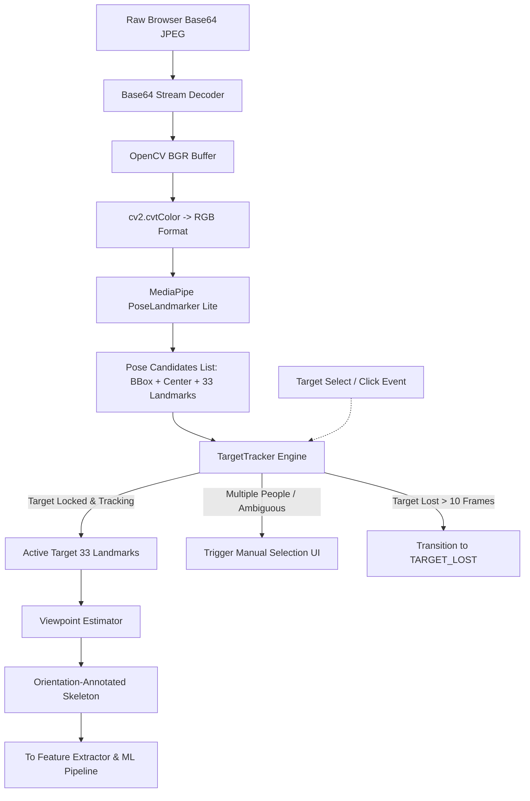

# PostureAI — Computer Vision, Target Tracking & Pose Estimation

**Document Code:** `DOC-05-VISION`  
**Relative Path:** `documents/05_COMPUTER_VISION_TRACKING_AND_POSE_ESTIMATION.md`  
**Vision Engine:** Google MediaPipe PoseLandmarker (BlazePose)  
**Tracking Engine:** Geometric IoU & Anatomical Signature Continuity Tracker  
**Orientation Engine:** Skeletal Differential Viewpoint Estimator  

---

## 1. Computer Vision Pipeline Architecture

PostureAI transforms raw monocular RGB webcam images into structured 3D kinematic skeletons and reliable single-target tracks. The vision subsystem operates in real time on standard consumer CPU/GPU hardware without requiring depth cameras:



---

## 2. MediaPipe PoseLandmarker Pipeline (`PoseProcessor`)

The vision subsystem is encapsulated in `PoseProcessor` (`ml/inference/pose_processor.py`):

### 2.1 Model Asset & Configuration
* **Model Asset:** `ml/models/pose_landmarker_lite.task` (~5.78 MB).
* **Execution Options:**
  ```python
  base_options = mp.tasks.BaseOptions(model_asset_path="ml/models/pose_landmarker_lite.task")
  options = mp.tasks.vision.PoseLandmarkerOptions(
      base_options=base_options,
      running_mode=mp.tasks.vision.RunningMode.IMAGE,
      num_poses=5,  # Supports up to 5 simultaneous candidate detections
      min_pose_detection_confidence=0.45,
      min_pose_presence_confidence=0.45,
      min_tracking_confidence=0.45,
  )
  self.landmarker = mp.tasks.vision.PoseLandmarker.create_from_options(options)
  ```
* **Why PoseLandmarker Lite?** It provides an ideal trade-off between inference speed (~15–25 ms per frame on modern CPU) and 3D joint accuracy, making it suitable for continuous real-time execution in background desktop workflows.

### 2.2 Frame Ingestion & Normalization
1. **Base64 Decoding:** Incoming WebSocket payloads contain JPEG data URLs (`data:image/jpeg;base64,...`). The header is stripped and bytes decoded via `base64.b64decode()`.
2. **Buffer Conversion:** The byte stream is converted to a NumPy array (`np.frombuffer`) and decoded into an uncompressed image array via `cv2.imdecode(..., cv2.IMREAD_COLOR)`.
3. **Color Space Alignment:** MediaPipe requires RGB order, so the image is transformed from OpenCV BGR via `cv2.cvtColor(img, cv2.COLOR_BGR2RGB)`.
4. **Candidate Extraction:** The detector locates all bodies in the image and returns 3D landmarks along with visibility confidence scores for each detected subject.

---

## 3. Target Selection & Zero-Switching Tracking (`TargetTracker`)

A major vulnerability of computer vision systems in real offices is **identity hopping**: when a coworker walks past in the background, naive bounding box algorithms switch targets, corrupting the primary user's posture history. 

PostureAI implements an explicit, robust target continuity engine (`ml/inference/target_tracker.py`) governed by one core safety principle:

> **CORE SAFETY GUARANTEE: NEVER SILENTLY SWITCH THE TARGET PERSON.**

```text
                                TARGET TRACKER STATE MACHINE
                                
   +-------------------------------------------------------------------------------+
   |                                                                               |
   |   [NO_TARGET]                                                                 |
   |        |                                                                      |
   |        v                                                                      |
   |   One person? ------ YES -------> [TARGET_TRACKING]                           |
   |        |                                 |                                    |
   |        NO (Multiple people)              | Occlusion / Brief Exit             |
   |        v                                 v                                    |
   |   [AWAITING_SELECTION]            [TEMPORARILY_LOST]                          |
   |        |                          (Hold state for 10 frames)                  |
   |        | User clicks target              |                                    |
   |        +-------------------------+       | Missing > 10 frames                |
   |                                  |       v                                    |
   |                                  +-> [TARGET_LOST]                            |
   |                                          |                                    |
   |                                          v                                    |
   |                                     [RESELECT_REQUIRED]                       |
   |                                                                               |
   +-------------------------------------------------------------------------------+
```

### 3.1 Bounding Box IoU Calculation
Frame-to-frame spatial overlap is quantified via Intersection over Union (IoU) of normalized bounding boxes:
$$\text{IoU}(A, B) = \frac{\operatorname{Area}(A \cap B)}{\operatorname{Area}(A) + \operatorname{Area}(B) - \operatorname{Area}(A \cap B)}$$

### 3.2 Anatomical Geometry Signature
Spatial IoU alone is insufficient if two individuals walk directly past one another (occlusion crossover). PostureAI extracts an invariant **anatomical geometry signature vector** from skeletal ratios (`extract_geometry_signature`):
$$\mathbf{S} = \begin{bmatrix} \frac{W_{\text{shoulder}}}{L_{\text{torso}}}, & \frac{D_{\text{head\_neck}}}{W_{\text{shoulder}}}, & \frac{H_{\text{bbox}}}{W_{\text{bbox}}} \end{bmatrix}$$
Because limb-to-torso proportions are anthropometrically unique and invariant to small camera movements, this signature prevents the tracker from latching onto a passerby even during spatial overlap.

### 3.3 Candidate Matching Score Function
To match detected candidates in frame $t$ against the locked target from frame $t-1$:
$$\text{Score}(c) = 0.50 \cdot (1 - \operatorname{Dist}(\mathbf{C}_{\text{cand}}, \mathbf{C}_{\text{target}})) + 0.30 \cdot \operatorname{IoU}(\mathbf{B}_{\text{cand}}, \mathbf{B}_{\text{target}}) + 0.20 \cdot \operatorname{Sim}(\mathbf{S}_{\text{cand}}, \mathbf{S}_{\text{target}})$$
* **Gating Conditions:** A candidate is rejected if:
  1. Center displacement exceeds $\text{MAX\_MATCH\_DISTANCE} = 0.20$ (normalized screen distance).
  2. Bounding box area ratio is outside $\text{MIN\_AREA\_RATIO} = 0.35$ (rejects background individuals).
  3. Combined match score $< \text{MIN\_MATCH\_SCORE} = 0.45$.

### 3.4 Temporal Grace Period & Reselection Guard
* **Grace Period (10 Frames / ~2.5 Seconds):** If the locked user temporarily ducks below the desk or experiences a camera flicker, the tracker enters `TEMPORARILY_LOST`. It preserves the user's historical state without resetting risk accumulators.
* **Reselection Trigger:** If the target is missing for $>10$ consecutive frames, the tracker transitions to `TARGET_LOST` and flags `reselection_required = True`. When the camera view restores, the frontend prompts the user to confirm their target box rather than guessing.

---

## 4. Skeletal Viewpoint Estimation (`viewpoint_estimator.py`)

Users place their webcams at varying positions—such as centered on a primary monitor, offset on a secondary screen, or laterally on a laptop stand. PostureAI determines the approximate orientation of the user relative to the camera vector:

```text
              CAMERA
                 |
                 v
         +---------------+
         |  VIEWPOINTS   |
         +---------------+
                 |
   +-------------+-------------+-------------+-------------+
   |             |             |             |             |
   v             v             v             v             v
 FRONT       LEFT_3_4      RIGHT_3_4   LEFT_PROFILE  RIGHT_PROFILE
(|yaw|<15°) (15°<=yaw<45°) (-45°<yaw<=-15°) (yaw>=45°)   (yaw<=-45°)
```

### 4.1 Mathematical Formulation of Orientation
Viewpoint is estimated using the 3D differential between left and right acromioclavicular joints (Landmarks 11 and 12):
$$W_x = |\mathbf{P}_{\text{right\_shoulder}}[x] - \mathbf{P}_{\text{left\_shoulder}}[x]|$$
$$\Delta z = \mathbf{P}_{\text{right\_shoulder}}[z] - \mathbf{P}_{\text{left\_shoulder}}[z]$$
$$\theta_{\text{yaw}} = \operatorname{atan2}(\Delta z, W_x) \times \frac{180}{\pi}$$

### 4.2 Classification Boundaries
```python
if abs(yaw_angle) < 15.0:
    return "FRONT"
elif 15.0 <= yaw_angle < 45.0:
    return "LEFT_3_4"
elif -45.0 < yaw_angle <= -15.0:
    return "RIGHT_3_4"
elif yaw_angle >= 45.0:
    return "LEFT_PROFILE"
elif yaw_angle <= -45.0:
    return "RIGHT_PROFILE"
else:
    return "UNKNOWN"
```

### 4.3 Architectural Purpose
The detected viewpoint is transmitted in every WebSocket message and displayed in the frontend header (`ViewpointIndicator.jsx`). This informs the user if their camera setup is excessively angled and provides orientation context to ensure feature consistency across setups.
