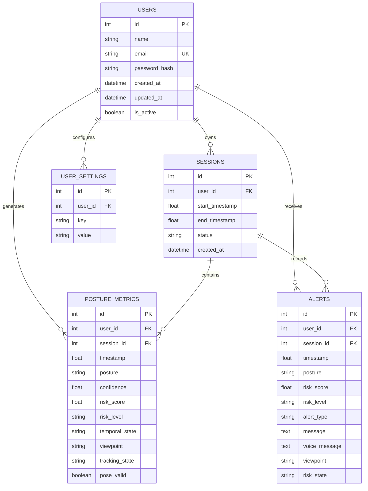

# PostureAI — Backend API & Database Architecture

**Document Code:** `DOC-07-BACKEND`  
**Relative Path:** `documents/07_BACKEND_API_AND_DATABASE_ARCHITECTURE.md`  
**API Engine:** FastAPI 0.115.0 / Uvicorn (ASGI)  
**ORM / Data Layer:** SQLAlchemy 2.0 Async (AsyncSessionLocal)  
**Database Drivers:** `aiosqlite` (SQLite) / `aiomysql` (MySQL)  
**Security Engine:** Argon2 Password Hashing & Signed HTTP-Only Session Cookies  

---

## 1. Database Architecture & Relational Schema

PostureAI utilizes a normalized relational schema engineered for high-frequency time-series logging, multi-user isolation, and historical analytics (`ml/persistence/models.py`).



### 1.1 Complete Model Definitions & Field Specifications

#### Table: `users`
Stores user identity and hashed credentials:
* `id` (`INTEGER PRIMARY KEY AUTOINCREMENT`): Unique user identifier.
* `name` (`VARCHAR(100)`, non-nullable): User's full display name.
* `email` (`VARCHAR(150)`, unique, indexed, non-nullable): Primary login credential.
* `password_hash` (`VARCHAR(200)`, non-nullable): Argon2 password digest.
* `created_at` / `updated_at` (`DATETIME`): Account audit timestamps.
* `is_active` (`BOOLEAN`, default `True`): Soft-deletion / account status toggle.

#### Table: `sessions`
Records distinct monitoring runs:
* `id` (`INTEGER PRIMARY KEY AUTOINCREMENT`): Monitoring session identifier.
* `user_id` (`INTEGER`, foreign key -> `users.id`, indexed, nullable): User owner.
* `start_timestamp` (`FLOAT`, non-nullable): Epoch timestamp of the first frame.
* `end_timestamp` (`FLOAT`, nullable): Epoch timestamp of session conclusion.
* `status` (`VARCHAR(20)`, default `"ACTIVE"`): Enum: `ACTIVE`, `COMPLETED`, `FAILED`.

#### Table: `posture_metrics`
High-frequency time-series table logging telemetry for each processed frame:
* `id` (`INTEGER PRIMARY KEY AUTOINCREMENT`): Metric record identifier.
* `session_id` (`INTEGER`, foreign key -> `sessions.id`, indexed, non-nullable).
* `user_id` (`INTEGER`, foreign key -> `users.id`, indexed, nullable).
* `timestamp` (`FLOAT`, non-nullable): Unix epoch timestamp with millisecond precision.
* `posture` (`VARCHAR(10)`, non-nullable): Predicted class (`TUP`, `TLF`, `TLB`, `TLL`, `TLR`).
* `confidence` (`FLOAT`, non-nullable): Model probability ($0.0 \le c \le 1.0$).
* `risk_score` (`FLOAT`, non-nullable): Blended risk score ($0.0 \le r \le 1.0$).
* `risk_level` (`VARCHAR(10)`, non-nullable): Application risk level (`NORMAL`, `WATCH`, `ALERT`).
* `temporal_state` (`VARCHAR(20)`, non-nullable): State machine mode (`NORMAL`, `WATCH`, `ACTIVE_RISK`, `RECOVERING`, `COOLDOWN`).
* `viewpoint` (`VARCHAR(20)`, nullable): Orientation (`FRONT`, `LEFT_3_4`, `RIGHT_3_4`, etc.).
* `tracking_state` (`VARCHAR(20)`, nullable): Target state (`TRACKING`, `TEMPORARILY_LOST`, etc.).
* `pose_valid` (`BOOLEAN`, nullable): Indicates if 33 landmarks satisfied kinematic integrity.

#### Table: `alerts`
Persistent audit log of all generated ergonomic alerts:
* `id` (`INTEGER PRIMARY KEY AUTOINCREMENT`): Alert event identifier.
* `session_id` (`INTEGER`, foreign key -> `sessions.id`, indexed, non-nullable).
* `user_id` (`INTEGER`, foreign key -> `users.id`, indexed, nullable).
* `timestamp` (`FLOAT`, non-nullable): Epoch timestamp when alert triggered.
* `posture` (`VARCHAR(10)`, non-nullable): Offending posture code.
* `risk_score` (`FLOAT`, non-nullable): Elevated risk score at alert instant.
* `risk_level` (`VARCHAR(10)`, default `"ALERT"`).
* `alert_type` (`VARCHAR(20)`, default `"RISK_ALERT"`).
* `message` (`TEXT`): Visual notification banner copy.
* `voice_message` (`TEXT`): Speech synthesis audio message script.
* `viewpoint` (`VARCHAR(20)`): User orientation at time of alert.
* `risk_state` (`VARCHAR(20)`): State machine status (typically `ACTIVE_RISK`).

#### Table: `user_settings`
Key-value preferences store scoped per user:
* `id` (`INTEGER PRIMARY KEY AUTOINCREMENT`).
* `user_id` (`INTEGER`, foreign key -> `users.id`, indexed, nullable).
* `key` (`VARCHAR(50)`, non-nullable): Setting identifier (e.g., `voice_enabled`, `sensitivity`).
* `value` (`VARCHAR(200)`): Serialized string value.
* Unique Constraint: `UniqueConstraint('user_id', 'key', name='_user_key_uc')`.

---

## 2. Authentication & Session Security Architecture

User security is managed in `ml/api/auth_router.py`:

```mermaid
sequenceDiagram
    autonumber
    actor Client as Frontend Client
    participant Auth as Auth Router (/api/auth)
    participant Argon as Argon2 Hasher
    participant Signer as TimestampSigner
    participant DB as Async Database

    Client->>Auth: POST /api/auth/register {name, email, password}
    Auth->>DB: Check if email already registered
    Auth->>Argon: hash(password)
    Auth->>DB: INSERT INTO users ...
    Auth->>Signer: sign(str(user.id))
    Auth-->>Client: Set-Cookie: session=token; HttpOnly; SameSite=Lax; Path=/
    
    Client->>Auth: GET /api/auth/me (Cookie: session=token)
    Auth->>Signer: unsign(token, max_age=86400)
    Auth->>DB: SELECT * FROM users WHERE id = user_id
    Auth-->>Client: 200 OK {id, name, email}
```

### 2.1 Password Hashing via Argon2
Passwords are encrypted using `argon2.PasswordHasher()`, the winner of the Password Hashing Competition (PHC). Argon2 provides memory-hard protection against GPU and ASIC brute-force attacks:
```python
ph = PasswordHasher()
hashed = ph.hash(payload.password)
# Verification:
ph.verify(user.password_hash, payload.password)
```

### 2.2 Cryptographically Signed Session Cookies
Instead of storing stateful sessions in memory, PostureAI utilizes tamper-proof signed cookies via `itsdangerous.TimestampSigner`:
* Token Generation: `token = signer.sign(str(user.id)).decode()`
* Token Unsigning: `user_id = int(signer.unsign(token, max_age=86400).decode())` (24-hour expiration).
* Cookie Flags: `httponly=True`, `samesite="lax"`, `secure=False` (configured to `True` under production HTTPS). Prevents XSS scripts from accessing credentials.

---

## 3. Real-Time WebSocket Communication Specification (`/ws`)

The WebSocket endpoint provides full-duplex communication for video frames and telemetry.

### 3.1 Client Inbound Messages (Browser $\to$ Server)

#### Message: `START_CALIBRATION`
```json
{ "type": "START_CALIBRATION" }
```
Instructs backend to enter calibration mode, clear historical buffers, and begin collecting baseline samples.

#### Message: `FINALIZE_CALIBRATION`
```json
{ "type": "FINALIZE_CALIBRATION" }
```
Instructs backend to calculate the median baseline across collected valid samples and reset temporal risk accumulators.

#### Message: `SELECT_TARGET`
```json
{
  "type": "SELECT_TARGET",
  "target_id": 2,
  "click_x": 0.452,
  "click_y": 0.381
}
```
Explicitly selects candidate target 2 by identifier or normalized screen coordinates.

#### Message: `RESET_TARGET` / `CHANGE_TARGET`
```json
{ "type": "RESET_TARGET" }
```
Clears target lock and resets `TargetTracker` to `SEARCHING`.

#### Message: `FRAME`
```json
{
  "type": "FRAME",
  "timestamp": 1793145620.104,
  "frame": "data:image/jpeg;base64,/9j/4AAQSkZJRgABAQ...",
  "select_target_id": null
}
```
Primary frame packet transmitted at 10–15 FPS.

---

### 3.2 Server Outbound Messages (Server $\to$ Browser)

#### Message: `POSTURE_UPDATE`
Streamed continuously on every evaluated frame:
```json
{
  "type": "POSTURE_UPDATE",
  "payload": {
    "timestamp": 1793145620.104,
    "posture": "TUP",
    "class_probabilities": {
      "TLB": 0.01, "TLF": 0.04, "TLL": 0.01, "TLR": 0.01, "TUP": 0.93
    },
    "confidence": 0.93,
    "viewpoint": "FRONT",
    "person_state": "ONE_PERSON",
    "tracking_state": "TRACKING",
    "target_selected": true,
    "target_id": 1,
    "target_confidence": 0.92,
    "target_bbox": { "x": 0.22, "y": 0.15, "width": 0.55, "height": 0.72 },
    "candidates": [...],
    "reselection_required": false,
    "pose_valid": true,
    "risk_score": 0.0,
    "risk_level": "NORMAL",
    "temporal_state": "NORMAL",
    "alert_event": null,
    "recommendation": "Maintain upright posture",
    "posture_evaluation": {
      "overall_status": "GOOD",
      "head": { "status": "GOOD", "pitch_deg": -32.1, "roll_deg": -0.4, "detail": "Head straight" },
      "shoulder": { "status": "GOOD", "asymmetry_ratio": 0.042, "detail": "Shoulders aligned" },
      "trunk": { "status": "GOOD", "pitch_deg": -21.4, "detail": "Trunk straight" }
    },
    "pose_landmarks": [
      { "x": 0.482, "y": 0.215, "z": -0.124 }, ... 33 items
    ],
    "calibration_state": "CALIBRATION_COMPLETE"
  }
}
```

#### Message: `ALERT`
Emitted immediately when sustained risk triggers an alert:
```json
{
  "type": "ALERT",
  "payload": {
    "timestamp": 1793145625.340,
    "posture": "TLF",
    "risk_score": 0.95,
    "risk_level": "ALERT",
    "alert_type": "RISK_ALERT",
    "message": "Trunk leaning forward detected — please adjust your posture.",
    "voice_message": "Trunk misaligned, please sit upright.",
    "viewpoint": "FRONT",
    "temporal_state": "ACTIVE_RISK",
    "recommendation": "Straighten your back and align your head over your shoulders.",
    "pose_landmarks": [...]
  }
}
```

---

## 4. REST Analytics Endpoints (`ml/api/analytics_router.py`)

All analytics endpoints require authentication via session cookie (`get_current_user` dependency):

```text
+--------+---------------------------------------+--------------------------------------------------------+
| METHOD | ENDPOINT ROUTE                        | PURPOSE & SUMMARY                                      |
+--------+---------------------------------------+--------------------------------------------------------+
| GET    | /api/analytics/summary                | Returns total monitoring time, good posture %, alerts  |
| GET    | /api/analytics/postures               | Returns posture observation counts, durations, matrix  |
| GET    | /api/analytics/sessions?limit=20      | Paginated list of user's past monitoring sessions      |
| GET    | /api/analytics/sessions/{id}          | Detailed timeline series, metrics & alerts for session |
| GET    | /reports/sessions/{id}                | Structured inspection report payload for export/audit  |
+--------+---------------------------------------+--------------------------------------------------------+
```

---

## 5. Analytics Calculation Engine (`ml/analytics/service.py`)

Analytics metrics are computed deterministically using **timestamp-interval math**:

### 5.1 Gap-Filtered Duration Accounting (`G_MAX` Algorithm)
In real-world usage, users close browser tabs, lock screens, or take lunch breaks. Simply subtracting `start_timestamp` from `end_timestamp` produces wildly inflated durations. 

PostureAI implements interval-by-interval processing bounded by a maximum valid interval threshold ($\text{G\_MAX} = 10.0\text{ seconds}$):
$$\Delta t_i = t_{i+1} - t_i$$
$$\text{If } 0 \le \Delta t_i \le \text{G\_MAX}: \quad \text{Duration}(\text{Posture}_i) \leftarrow \text{Duration}(\text{Posture}_i) + \Delta t_i$$
$$\text{If } \Delta t_i > \text{G\_MAX}: \quad \text{Discard gap (user away / camera paused)}$$

### 5.2 Transition Matrix Computation
To identify habitual posture degradation patterns (e.g., how frequently a user transitions from `TUP` into `TLF`):
$$M_{A \to B} = \sum_{i=1}^{N-1} \mathbb{I}\left(P_i = A \land P_{i+1} = B \land A \ne B \land \Delta t_i \le \text{G\_MAX}\right)$$
This matrix powers the visual transition heatmap in the user dashboard.
