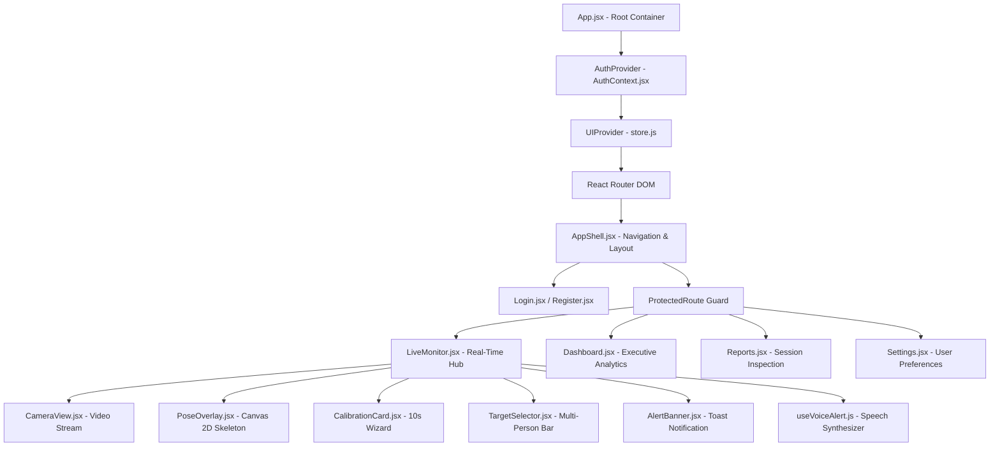
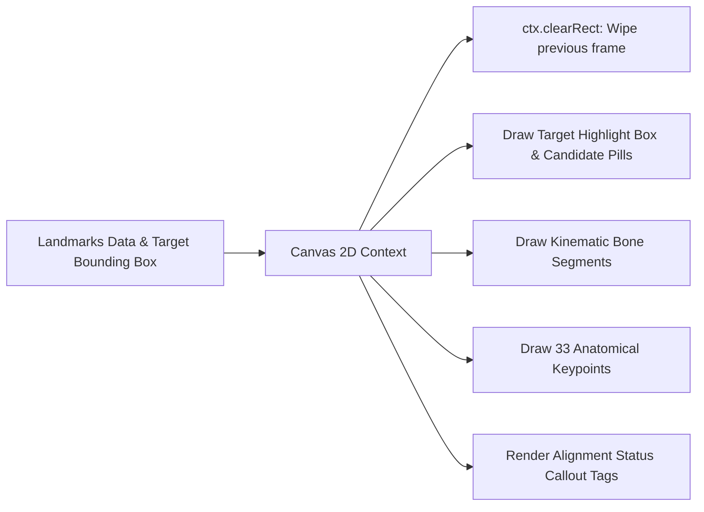

# PostureAI — Frontend Architecture, UI/UX & Client State

**Document Code:** `DOC-08-FRONTEND`  
**Relative Path:** `documents/08_FRONTEND_ARCHITECTURE_AND_UI_UX.md`  
**Core Framework:** React 18.2 / Vite 5.2 (Single Page Application)  
**Styling Framework:** Tailwind CSS 3.4 (Modern Dark Mode System)  
**Data Visualization:** Recharts 2.15  
**Audio Synthesizer:** Native HTML5 Web Speech API (`SpeechSynthesis`)  

---

## 1. Frontend Architectural Overview

The PostureAI frontend is built as a high-performance single-page application (SPA). Designed for desk workers, it delivers clear visual feedback, minimal CPU overhead, and non-distracting user interactions:



---

## 2. Component Hierarchy & Page Architecture

### 2.1 Live Monitor Page (`frontend/src/pages/LiveMonitor.jsx`)
The operational nerve center of the application:
* **Real-Time Video & Canvas Overlay:** Displays the live camera feed with an overlaid transparent HTML5 `<canvas>` rendering 33 skeletal joints and colored kinematic bones.
* **Multi-Target Selection Bar (`TargetSelector.jsx`):** Detects multiple people in the frame and displays interactive candidate selection pills (`"Person 1"`, `"Person 2"`, etc.) alongside direct click-to-select canvas interaction.
* **Personal Calibration Card (`CalibrationCard.jsx`):** Guides the user through a 10-second posture calibration routine with an animated progress bar and live status readouts.
* **Live Posture Status Badge (`PostureStatus.jsx`):** Displays real-time three-state health indicators (`GOOD` / `MODERATE` / `BAD`) alongside anatomical sub-system badges (Head, Shoulders, Trunk).
* **Temporal Risk Indicator (`RiskIndicator.jsx`):** Visualizes the continuous risk score ($0.0 \to 1.0$) with color-coded gradients (Green $\to$ Amber $\to$ Rose).
* **Actionable Recommendation Card (`RecommendationCard.jsx`):** Delivers specific ergonomic adjustments (e.g., *"Elevate monitor or raise chair height"*).

### 2.2 Executive Dashboard (`frontend/src/pages/Dashboard.jsx`)
Aggregates historical data to provide macro-level ergonomic insights:
* **KPI Header Cards (`KpiCard.jsx`):** Summarizes Total Monitored Time, Good Posture Compliance Percentage, Active Alerts Count, and Lifetime Sessions.
* **Posture Distribution Chart (`PostureDistributionChart.jsx`):** Interactive Recharts donut visualization showing the percentage breakdown of time spent in `TUP`, `TLF`, `TLB`, `TLL`, and `TLR`.
* **Transition Heatmap Matrix (`TransitionHeatmap.jsx`):** A $5 \times 5$ color-intensity matrix displaying how frequently the user slipped from neutral posture into slumped postures.
* **Recent Sessions List:** Quick-access table linking to detailed session breakdowns.

### 2.3 Comprehensive Session Reports (`frontend/src/pages/Reports.jsx`)
Allows deep-dive audits of individual monitoring sessions:
* **Interactive Timeline Series (`SessionTimelineChart.jsx`):** Renders continuous second-by-second risk levels throughout a session. Critical alert events are highlighted with pulse markers.
* **Session Summary Table:** Audits start time, duration, dominant posture, and alert incidents.
* **PDF / JSON Report Export:** Facilitates exporting clinical session summaries for physical therapists.

### 2.4 User Settings & Preferences (`frontend/src/pages/Settings.jsx`)
Enables personalization of operational thresholds:
* Voice Alert toggle (`voice_enabled`).
* Alert sensitivity slider (`persistence_duration` adjustment between 2.0s and 8.0s).
* Camera input device selector for multi-monitor / external webcam setups.

---

## 3. Custom Hooks Ecosystem

State and hardware interactions are decoupled into reusable custom hooks:

```text
+---------------------+-----------------------------------------------------------------------------------+
| CUSTOM HOOK         | CORE RESPONSIBILITY & IMPLEMENTATION DETAILS                                      |
+---------------------+-----------------------------------------------------------------------------------+
| useCamera.js        | Wraps navigator.mediaDevices.getUserMedia; manages stream state                   |
|                     | (INITIALIZING, ACTIVE, ERROR, STOPPED); ensures camera tracks stop on unmount.   |
+---------------------+-----------------------------------------------------------------------------------+
| useWebSocket.js     | Manages full WebSocket connection lifecycle (/ws); automatic reconnect backoff;   |
|                     | serializes outbound JSON and deserializes inbound telemetry messages.             |
+---------------------+-----------------------------------------------------------------------------------+
| useMonitoring.js    | Central conductor hook. Coordinates camera frame capture, canvas serialization,    |
|                     | WebSocket dispatch, calibration lifecycle, and target selection commands.        |
+---------------------+-----------------------------------------------------------------------------------+
| useAlertManager.js  | Ingests raw ALERT payloads; enforces a 10-second auto-dismissal timer; provides    |
|                     | manual dismiss handlers; prevents duplicate alert stacking.                       |
+---------------------+-----------------------------------------------------------------------------------+
| useVoiceAlert.js    | Integrates window.speechSynthesis; throttles repeated utterances; generates       |
|                     | natural vocal reminders ("Trunk misaligned, please sit upright").                 |
+---------------------+-----------------------------------------------------------------------------------+
```

---

## 4. Skeletal Canvas Rendering Engine (`PoseOverlay.jsx`)

To achieve 60 FPS rendering without taxing the CPU, `PoseOverlay.jsx` draws directly onto an HTML5 2D canvas aligned over the `<video>` element:



### 4.1 Color-Coded Kinematic Bones
Skeletal segments are color-coded dynamically based on the current posture evaluation:
* **Spine / Torso Segment (Mid-Shoulder to Mid-Hip):**
  * Green (`#10B981`) if trunk is neutral upright.
  * Red (`#EF4444`) if trunk pitch exceeds $25^\circ$ forward slump or backward lean.
* **Cervical Segment (Mid-Shoulder to Nose):**
  * Green (`#10B981`) if head is aligned.
  * Red (`#EF4444`) if head roll or forward displacement is elevated.
* **Shoulder Girdle (Left Shoulder to Right Shoulder):**
  * Green (`#10B981`) if horizontal.
  * Amber (`#F59E0B`) or Red (`#EF4444`) if asymmetry ratio $> 0.10$.

---

## 5. Modern Design System & Aesthetics

PostureAI employs a curated, professional dark-mode design system built in Tailwind CSS:

```text
+-------------------+-----------------------------------+-----------------------------------------+
| PALETTE TOKEN     | HEX CODE / TAILWIND CLASS         | UI USAGE & SEMANTICS                    |
+-------------------+-----------------------------------+-----------------------------------------+
| Deep Background   | #0b0f17  (bg-[#0b0f17])           | Main application background canvas      |
| Card Surface      | #111827  (bg-slate-900 / gray-900)| Elevated surface cards & dashboard tiles|
| Glass Border      | rgba(255,255,255,0.08)            | Subtle frosted glass component borders  |
| Primary Text      | #F8FAFC  (text-slate-50)          | High-contrast headings & primary values |
| Muted Text        | #94A3B8  (text-slate-400)         | Descriptive subtitles & metadata labels |
| Emerald Accent    | #10B981  (emerald-500)            | GOOD posture, healthy metrics, success  |
| Amber Accent      | #F59E0B  (amber-500)              | WATCH state, moderate deviation warning |
| Rose Accent       | #EF4444  (rose-500 / red-500)     | ACTIVE_RISK alert, severe misalignment  |
| Sky Blue Accent   | #38BDF8  (sky-400)                | Active session timers, camera badges    |
+-------------------+-----------------------------------+-----------------------------------------+
```

### 5.1 Ergonomic UX Design Considerations
* **Non-Disruptive Peripheral Feedback:** Desk workers need feedback that does not interrupt their flow state. Status indicators are placed in the peripheral border of the screen, and audio reminders are soft and spaced out.
* **Full Keyboard Accessibility:** Interactive candidate selection and modal dialogs support standard keyboard navigation (`Tab`, `Enter`, `Esc`).
* **Fluid Responsive Layout:** Adapts seamlessly between side-docked split windows ($500\text{px}$ width) and full-screen multi-monitor dashboard views.
